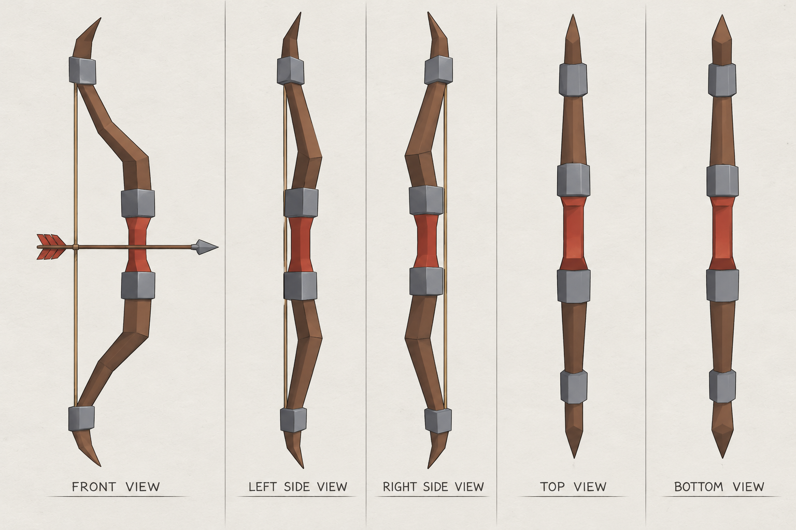
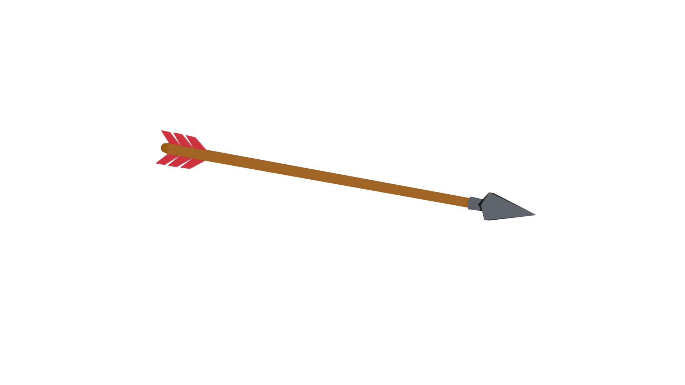
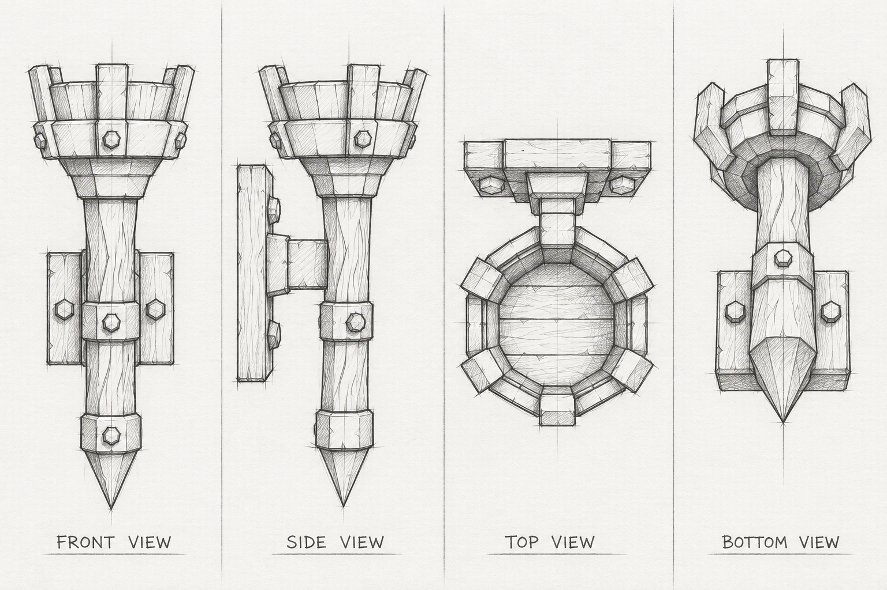
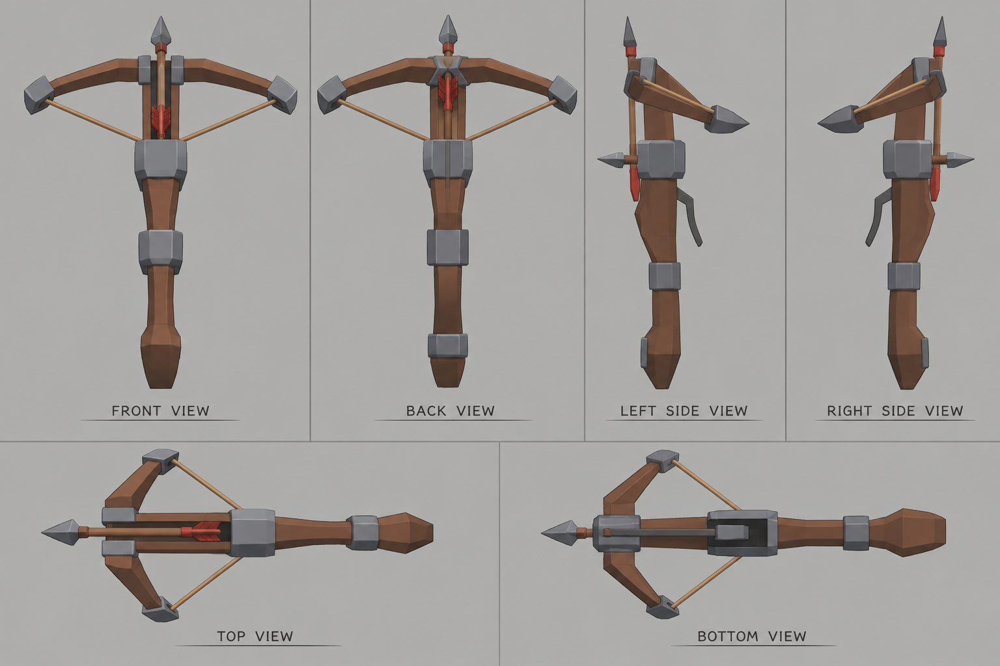
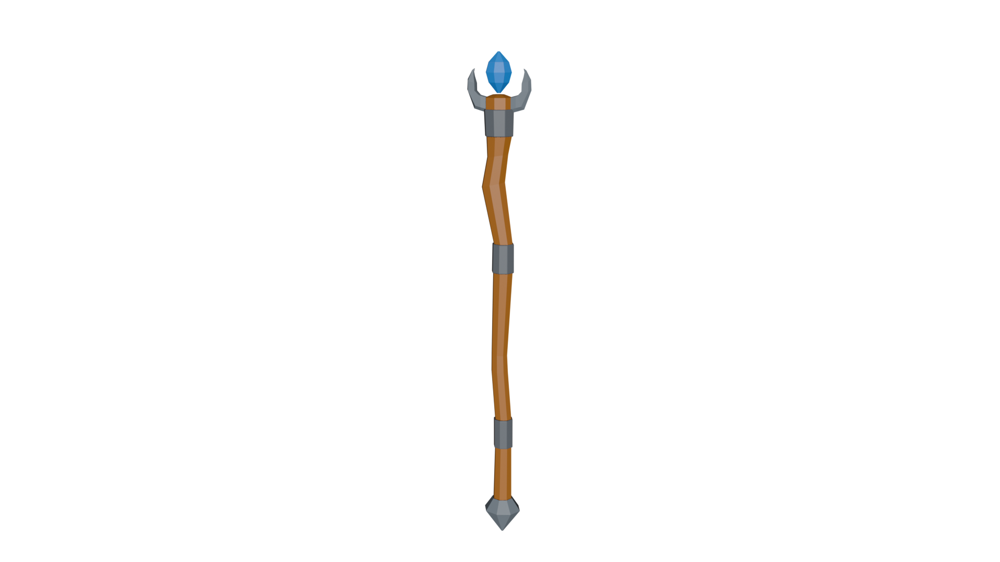

# Game Assets

Low-poly 3D assets modeled in Blender and exported for Godot. Click an image to open that asset's directory.

## Colors Used

- **Wood:** #B8732E
- **Cool Metal Gray:** #9AA3AB
- **Dark Iron:** #6B7178
- **Silver:** #D9DEE2

## Directory Contents

Each model has its own directory, and every directory holds the same types of files:

- **Project file:** the Blender `.blend` file with the model, materials, and UVs
- **Reference images:** the sketches and concept images used while modeling
- **GLB import file:** the `.glb` export, ready to import into Godot
- **Model image:** a PNG render of the finished model

## Usage

- **Blender:** open the `.blend` file in the model's directory.
- **Godot:** copy the `.glb` file into your Godot project (for example `res://models/`) and Godot will import it automatically.

---

## Bow and Arrow

<table>
  <tr>
    <td align="center">
      
    </td>
    <td align="center">
      
    </td>
  </tr>
</table>

## Wall Torch

<table>
  <tr>
    <td align="center">
      
    </td>
    </td>
  </tr>
</table>

## Crossbow

<table>
  <tr>
    <td align="center">
      
    </td>
    </td>
  </tr>
</table>

## Wizard Staff

<table>
  <tr>
    <td align="center">
      
    </td>
    </td>
  </tr>
</table>

